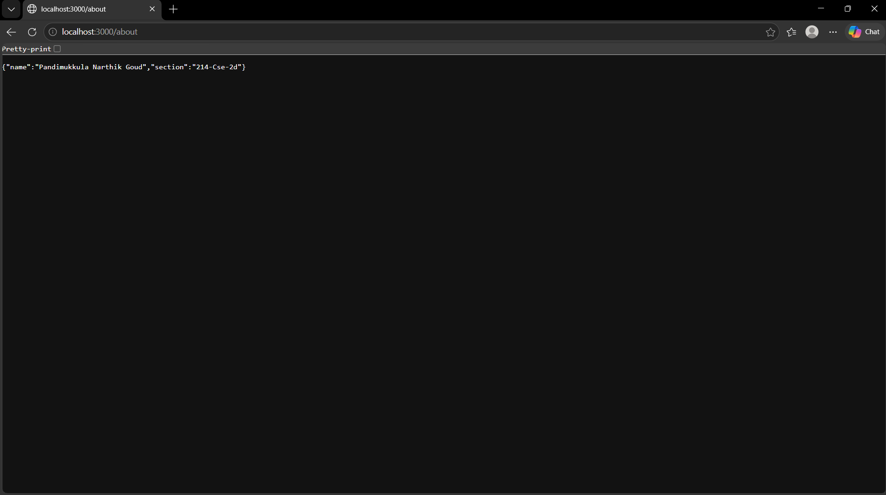
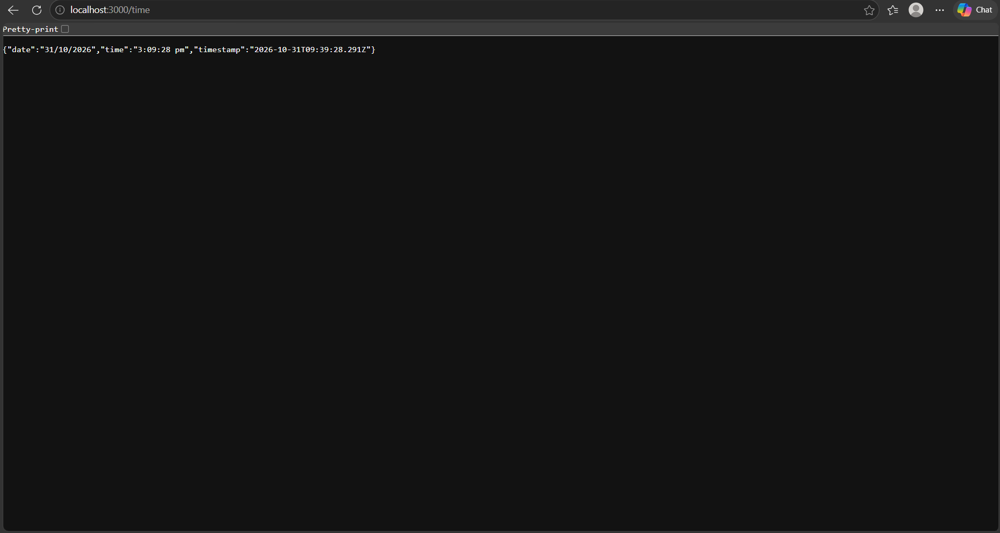
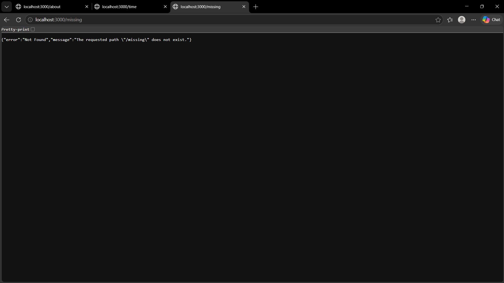

# Lab 1: Node.js and Express server

**Name:** Pandimukkula Narthik Goud  
**Registration number:** 252U1R1180  
**Class / Section:** 214-Cse-2d  

## Live link
https://bdm-lab-1.onrender.com

## Objective
Create a basic server first with Node.js' built-in `http` module and then with Express. Add routes, return correct HTTP status codes, and log the status code for each request.

## Project structure

```text
lab-01-node-express/
├── screenshots/
│   ├── home-route.png
│   ├── about-route.png
│   ├── time-route.png
│   └── not-found-route.png
├── src/
│   └── http-server.js
├── .env.example
├── .gitignore
├── package.json
├── package-lock.json   (created by npm install)
├── README.md
└── server.js
```

## Requirements
- Node.js 18 or later
- npm (included with Node.js)

## Install and run

Open a terminal in this folder and run:

```bash
npm install
npm start
```

The Express server starts at `http://localhost:3000`.

To run the built-in Node.js HTTP server instead, open another terminal and run:

```bash
npm run start:http
```

It starts at `http://localhost:3001` and returns `Hello` at `/`.

### Environment variables
The Express server uses `PORT` (default: `3000`). The built-in HTTP server uses `HTTP_PORT` (default: `3001`). They are optional; no `.env` file is required. If you use a `.env` file in a future extension, keep it private and never commit it.

## Endpoints

| Method | Path | Success status | Description |
|---|---|---:|---|
| GET | `/` | 200 | Displays a welcome message. |
| GET | `/about` | 200 | Returns the student's name and class section as JSON. |
| GET | `/time` | 200 | Returns the current server date, time, and ISO timestamp. |
| Any | Unknown path | 404 | Returns a JSON not-found message. |

### Example responses

`GET /`
```text
Welcome to the Node.js and Express server!
```

`GET /about`
```json
{
  "name": "Pandimukkula Narthik Goud",
  "section": "214-Cse-2d"
}
```

`GET /time` returns the current date/time at the moment the request is made. Its values will therefore change on each request.

Unknown path (example: `GET /missing`)
```json
{
  "error": "Not Found",
  "message": "The requested path \"/missing\" does not exist."
}
```

## Screenshots

The response previews below document the expected local route output. Run the server and open each URL in a browser to capture fresh screenshots from your own machine for final submission.

### Home route — `GET /`
![Home route response]

### About route — `GET /about`
![About route response]

### Time route — `GET /time`
![Time route response]

### Unknown route — `GET /missing`
![404 response]

## Task completion notes

1. Created the project metadata with `npm init`-style `package.json` fields.
2. Added Express as a project dependency. Run `npm install` to create `node_modules/` locally.
3. Implemented a plain server with `http.createServer()` in `src/http-server.js`.
4. Implemented the Express application using `express()` and `app.listen()`.
5. Added `/`, `/about`, and `/time` GET routes.
6. Added a 404 handler for unknown paths.
7. Added request logging that prints the HTTP method, path, and final status code.

## Viva preparation

- **`package.json` vs `node_modules`:** `package.json` describes the project and lists dependencies and scripts. `node_modules` contains the installed package files. It is generated by npm and should not be committed.
- **What does `app.listen()` do?** It starts the Express application listening for incoming connections on the specified port.
- **What are request and response?** `req` contains information about the incoming HTTP request (such as method, path, and query data). `res` is used to send the HTTP response (status, headers, and body).

## Problems faced and solutions
- **Port already in use:** Stop the other process or start the server with a different `PORT` value.
- **Express module not found:** Run `npm install` from this project folder before starting the server.

## GitHub submission

Create or use your course repository, place this folder inside it as `lab-01/`, and push the source files. Do not upload `node_modules/` or any `.env` file.
